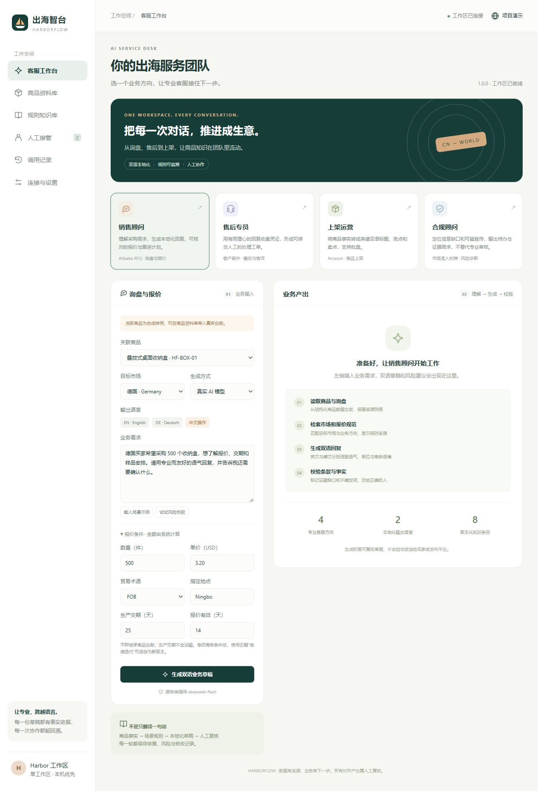
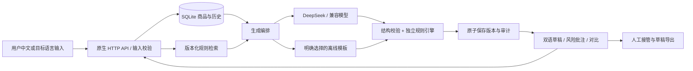

# 出海智台 · HarborFlow

面向中小外贸团队的多业务 AI 客服与人工协作工作台。四个方向：**销售顾问、售后专员、上架运营、合规顾问**。共享商品事实和规则知识，生成英文／德文草稿，保留独立校验、两轮以上修订与人工接管记录。



## 运行（Node.js 24 LTS）

无需安装运行时 npm 依赖。Windows、macOS、Linux 均可使用标准 Node.js 24 发行版。

```bash
git clone https://github.com/slashzyc/1.git
cd 1
node --env-file-if-exists=.env server.js
```

打开 http://127.0.0.1:3000 。不配置密钥也能用明确标注的“离线演示模板”。模板仅识别简短、样品、跟进等预设修改，不等于大模型推理。真实模式失败不会偷偷降级。

如果有 npm，也可用 `npm start`、`npm test`、`npm run check`、`npm run build`。工程无需网络安装依赖。

## 真实 DeepSeek 模式

复制 `.env.example` 为 `.env`，仅在本机填写 `MODEL_API_KEY`。默认端点是 `https://api.deepseek.com`，模型为 `deepseek-flash`，随后重启。也可通过 `node server.js --key-stdin` 在终端隐藏输入密钥，仅保存在进程内存。不要把密钥填进业务需求、商品资料或 GitHub。

兼容其他 Chat Completions JSON 服务时设置 `MODEL_BASE_URL`、`MODEL_NAME`、`MODEL_API_KEY`。Base URL 不包含 `/chat/completions`。OpenAI 官方一般使用 `https://api.openai.com/v1`；不同模型的参数能力须实测。真实模式向配置的服务商发送本次必要的商品资料、业务需求、相关规则和最近两轮草稿。

## 五分钟体验

1. 打开销售顾问，选 HF-BOX-01、德国市场，数量 500、单价 USD 3.20。
2. 输入采购需求，生成英德回复与程序计算的 USD 1,600.00 商品小计。
3. 查看“风险与批注”：样例缺少欧盟责任人等资料，不能声称已完成合规。
4. 连续两次“继续迭代”：先“更简短”，再“补充样品与跟进”。查看 V1/V2/V3。
5. 点击“转上架”，复用同一商品快照，生成 Amazon 标题、Item Highlights 与卖点。
6. 切到售后专员，输入破损客诉；点击“转人工”，认领工单并填写处理说明。
7. 上架工作流可勾选最多 5 个商品批量生成；每项独立显示结果。

## 数据与配置

- `fixtures/products.json`：3 个明确标注的合成家居商品。所有人物、交易和企业背景均不声称真实。
- `knowledge/rules.json`：8 条带来源、类型、适用市场、工作流与复核日期的规则。按标签检索，不使用向量库，不在运行时爬取平台。
- `config/agents.json`：平台配置导出，包含四个角色、工作流、能力、模型环境变量和反馈机制。
- 商品资料库支持 JSON 导入／更新，1–100 个商品、请求体最多 256 KB；完整校验后原子提交。可下载当前台账作为样例。
- `data/harborflow.sqlite`：本地商品、任务、不可覆盖的版本、工单和审计；自动创建，已从 Git 排除。
- 对外产出可导出 JSON 草稿包（双语、报价、风险、依据、完整历史）；API 另提供 Markdown 导出。

默认只覆盖美国／德国、普通非电气家居商品。其他品类可以导入数据，但需要补充规则和专业审核；系统会对检测到的食品接触、儿童、电气等用途提示覆盖缺口。公开平台指引不是完整的平台发布规则集合。

## 验证

```bash
node scripts/check.mjs
node --test --test-concurrency=1 tests/*.test.js
# 在另一个终端启动服务后：
node scripts/demo.mjs
node scripts/demo.mjs --live
node scripts/build.mjs
```

`--live` 会实际消耗模型服务额度：询盘 + 两次修订 + 关联 Listing + 售后 + 合规，共 6 次业务生成；单次上游最多 2 次尝试。验证输出保存到 `data/live-verification.json`，每步写检查点；失败明确标记 `failed`。最终记录见 `docs/VERIFICATION.md` 和已脱敏的 `docs/evidence/`。

32 项自动化测试覆盖金额、输入、四种角色、双语、规则检索、风险检测、商品快照、数据持久化、原子导入、修订冲突、幂等、批量部分失败、鉴权、Origin／Host 防护、请求体限制、Listing 场景错配、有限修正和模型异常。上游 Mock 测试与真实模型验收分开记录。

## 架构



报价只由整数分计算，模型不能修改报价表。规则引擎同时检查输入和生成结果。HTTP 429／5xx、网络问题和不完整结构最多重试一次，总模型等待预算默认 60 秒；失败不创建成功版本，返回错误码与请求 ID。修订有乐观锁，防止覆盖其他版本。幂等键只对已完成请求提供重放；进程崩溃窗口不承诺绝对 exactly-once，需结合审计核对。

## 商业试点部署

这是**按商业工程方式实现的单工作区试点产品**，不是已经完成全部生产审计的多租户 SaaS。包含访问口令边界、CSP、输入限制、参数化 SQL、版本留痕、限流、模型超时、错误隔离和非 root 容器配置。工作流角色不等于岗位访问权限。

对外监听必须设置至少 24 字符的 `APP_TOKEN`；使用反向代理终止 TLS，并设置 `APP_ORIGIN=https://你的域名`。口令在浏览器内存中使用，不持久化。不要直接把端口裸露在公网。

```bash
# 先在本机 .env 中配置 APP_TOKEN、模型参数
docker compose up --build -d
```

Docker 配置仍只把服务映射到宿主机回环地址。交付环境未运行 Docker，需在部署目标验证。正式多人商业化还需 SSO/RBAC、多租户隔离、备份恢复演练、TLS 运维、可观测性、成本配额、隐私与模型供应商数据协议、行业合规覆盖及语言专家验收。详见 `SECURITY.md` 与 `docs/OPERATIONS.md`。

## 比赛交付

| 交付物 | 位置 |
|---|---|
| 产品设计与开发流程 | `docs/PRODUCT_PLAN.md` |
| 验收映射与数据流 | `docs/ACCEPTANCE.md`、`docs/API.md` |
| 配置导出 | `config/agents.json`、`knowledge/rules.json` |
| 0.8 × 1.8 m 印刷海报 | `deliverables/harborflow-poster-800x1800mm.pdf` |
| 3 分钟离线路演 | `deliverables/harborflow-roadshow.html`，双击可打开 |
| 现场演示讲稿 | `docs/DEMO_SCRIPT.md` |
| 完整工程构建 | `dist/harborflow/`（运行 build 生成） |
| 第三方声明 | `THIRD_PARTY_NOTICES.md` |
| 最终标签 | `hackathon-final` |

## 规则与技术参考

- [Amazon 2026 标题公告](https://sellercentral.amazon.com/seller-forums/discussions/t/ac660707-60c7-43e3-a3fd-420d7321cc4e)：非媒体类标题 75 字符、Item Highlights 125 字符的保守基线，具体站点／类目仍需复核。
- [Alibaba RFQ 场景指引](https://seller.alibaba.com/rfq?locale=en)：按买家需求准备报价。
- [EU GPSR 原文](https://eur-lex.europa.eu/eli/reg/2023/988/oj/eng)及[官方摘要](https://eur-lex.europa.eu/legal-content/EN/TXT/?uri=LEGISSUM:4670517)：远程销售信息初筛。
- [FTC Green Guides 摘要](https://www.ftc.gov/business-guidance/resources/environmental-claims-summary-green-guides)：环保宣传证据边界。
- [DeepSeek 接口](https://api-docs.deepseek.com/zh-cn/)与[JSON 请求参数](https://api-docs.deepseek.com/api/create-chat-completion/)；[OpenAI Chat Completions 参考](https://developers.openai.com/api/reference/resources/chat)。

不包含平台账号、不自动上架或发送买家消息、不提供法律认证结论、不声称已提升转化率。代码授权未由项目所有者指定，默认保留权利（UNLICENSED）。
